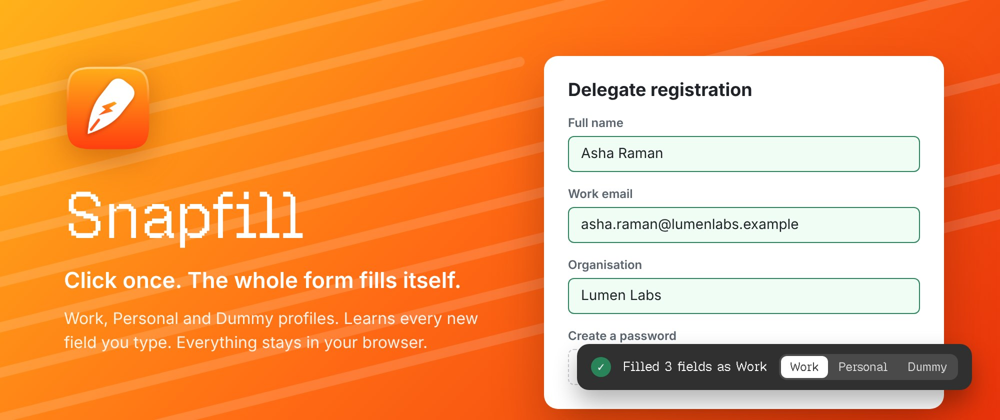
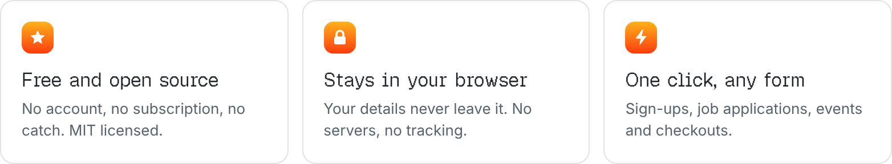
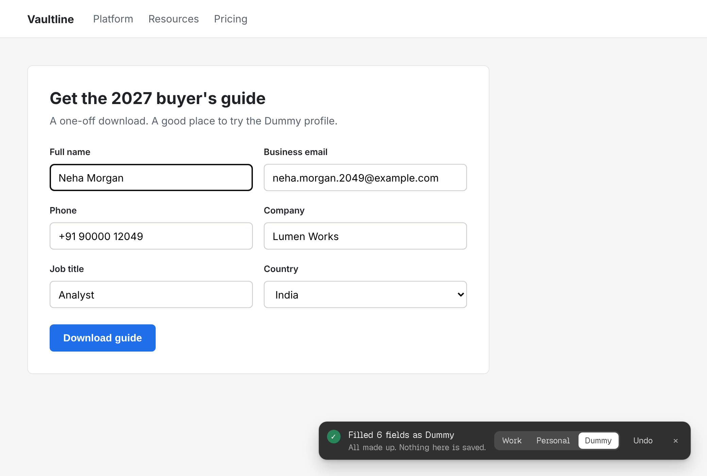
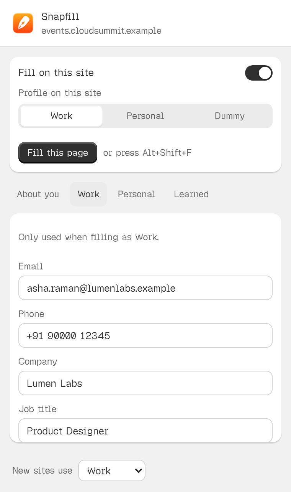
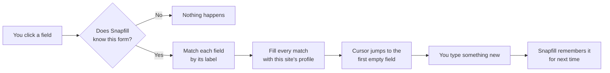

<p align="center">
  
</p>

<h1 align="center">Snapfill</h1>

<p align="center"><b>Click once. The whole form fills itself.</b></p>

<p align="center">
  A browser extension that remembers your details, learns new ones as you type,<br>
  and keeps everything in your browser. Free and open source.
</p>

<p align="center">
  <a href="LICENSE"></a>
  
  
  <a href="https://github.com/itsgrj/Snapfill/releases/latest"></a>
  <a href="https://github.com/itsgrj/Snapfill/stargazers"></a>
</p>

<p align="center">
  <a href="https://github.com/itsgrj/Snapfill/releases/latest/download/Snapfill.zip"></a>
</p>

<p align="center">
  
</p>

<p align="center">
  <picture>
    <source media="(prefers-color-scheme: dark)" srcset="docs/readme/promises-dark.png">
    
  </picture>
</p>

Every sign-up, registration and job application asks the same things: your name, your email,
your phone, where you work. Snapfill types them for you. Click the first field of any form and
everything it knows fills in at once, and your cursor lands on whatever is still empty.

## Fill any form

Click the first field. That is the whole interaction.


### One click, every field

Click into a form and Snapfill fills every field it recognises, together. It reads each
field's label, so *Work email*, *Business email* and *Email address* all get your email, and
*Organisation* gets your company. Your cursor then jumps to the first field that is still
empty. Nothing fills until you click, and Undo is right there.

<br clear="left">
<br>


### It learns as you type

Type something Snapfill has never seen, like a notice period, and click away. It remembers it,
so the next form that asks gets it too, even when the label is worded differently. One click
keeps it to a single profile, and Undo forgets it.

<br clear="left">
<br>



### Work, Personal, or Dummy

Keep your work email and your Gmail apart. Each site remembers the profile you last used
there, and you can switch from the message after a fill. For a one-off download you would rather
not give real details to, pick Dummy: it makes up every field, fresh each time, and saves
nothing.

<br clear="left">
<br>

| What the form asks | What Snapfill fills |
|---|---|
| Work email, Business email, Email address | Your email for the profile in use |
| First name, Last name, Full name | Your name, split or joined to fit |
| Date of birth (DD/MM/YYYY) | Your birthday, in the format the field asks for |
| Country (a dropdown) | The matching option |
| LinkedIn URL, after you typed it once as LinkedIn profile | What you typed the first time |
| Create a password | Nothing. Passwords are always left to you |

### And the small things

- **Ignore any site.** Turn off one switch in the toolbar popup, or list sites under **Ignored**.
  One entry can cover a whole domain, so `mybank.com` also covers `netbanking.mybank.com`.
- **Fill again on demand.** Press <kbd>Alt</kbd> <kbd>Shift</kbd> <kbd>F</kbd> on any form.
- **Never touches secrets.** Passwords, card numbers, one time codes, PAN, Aadhaar and passport numbers are skipped every time.
- **Leaves sign-in boxes alone.** An email and a password is a sign-in, and your password manager handles that.
- **Works with modern sites.** React, Vue and Google Forms style fields all fill, and so do forms that load late or sit inside a frame.

## Your details stay with you



Snapfill has no servers. It makes no network requests, has no analytics and no account. What
you save lives in your browser's own extension storage, on your computer, and goes away when
you remove the extension.

| Permission | Why Snapfill needs it |
|---|---|
| Read and change data on sites you visit | To find a form's fields and fill them when you click one |
| Storage | To keep your profiles in your browser |
| Active tab | To fill the page you are on when you use the popup or the shortcut |

Read more in [PRIVACY.md](PRIVACY.md).

<br clear="right">

## Get started

1. Download [`Snapfill.zip`](https://github.com/itsgrj/Snapfill/releases/latest/download/Snapfill.zip)
   from the latest release and unzip it.
2. Open your browser's extensions page: `chrome://extensions` in Chrome, Brave and Arc,
   `edge://extensions` in Edge, `dia://extensions` in Dia.
3. Turn on **Developer mode**, click **Load unpacked**, and choose the unzipped `Snapfill` folder.
4. Pin Snapfill to your toolbar, open it, and fill **About you**, **Work** and **Personal** once.
   Or skip that: fill forms as usual and it learns as you type.
5. Open any form and click the first field.

Want to try it on a safe page first? The [`demo`](demo) folder has three sample forms.

## Requirements

| You need | |
|---|---|
| Browser | Chrome, Edge, Brave, Arc, Dia, or any browser built on Chromium |
| Extensions | Developer mode on, to load the folder |
| Permissions | The three in the table above |

## How it works



```text
Snapfill/
├── extension/          The extension itself. Load this folder.
│   ├── manifest.json
│   ├── src/
│   │   ├── shared.js     Field matching, profiles and Dummy details
│   │   ├── content.js    Fills on the first click, learns, shows the message
│   │   └── background.js The Alt+Shift+F shortcut
│   ├── popup/            The toolbar popup and profile editor
│   ├── icons/
│   └── fonts/            Geist Pixel
├── demo/               Sample forms to try it on
└── docs/readme/        Images for this page
```

## Build from source

There is nothing to build. Clone the repository and load the `extension` folder:

```bash
git clone https://github.com/itsgrj/Snapfill.git
```

Then follow steps 2 to 5 of [Get started](#get-started), choosing `Snapfill/extension`.
After you change a file, click the reload arrow on Snapfill's card. More in
[CONTRIBUTING.md](CONTRIBUTING.md).

## Contributing

Bug reports, ideas and pull requests are welcome. A form Snapfill fills wrongly or skips is the
most useful report you can send. Read [CONTRIBUTING.md](CONTRIBUTING.md) first, and the
[code of conduct](CODE_OF_CONDUCT.md).

## License

Snapfill is released under the [MIT License](LICENSE). The Geist Pixel font in
`extension/fonts` is released under the [SIL Open Font License](extension/fonts/OFL.txt).

## Acknowledgements

Snapfill stands on these:

- [Geist Pixel](https://github.com/vercel/geist-font) by Vercel and basement.studio, the type in the popup and messages.
- [Shopify Polaris](https://polaris.shopify.com), whose design language shaped the popup and messages.
- [Shields.io](https://shields.io) for the badges on this page.

<br>

<p align="center"><b>You have better things to do than type your email again.</b></p>

<p align="center">
  <a href="https://github.com/itsgrj/Snapfill/releases/latest/download/Snapfill.zip"></a>
</p>
